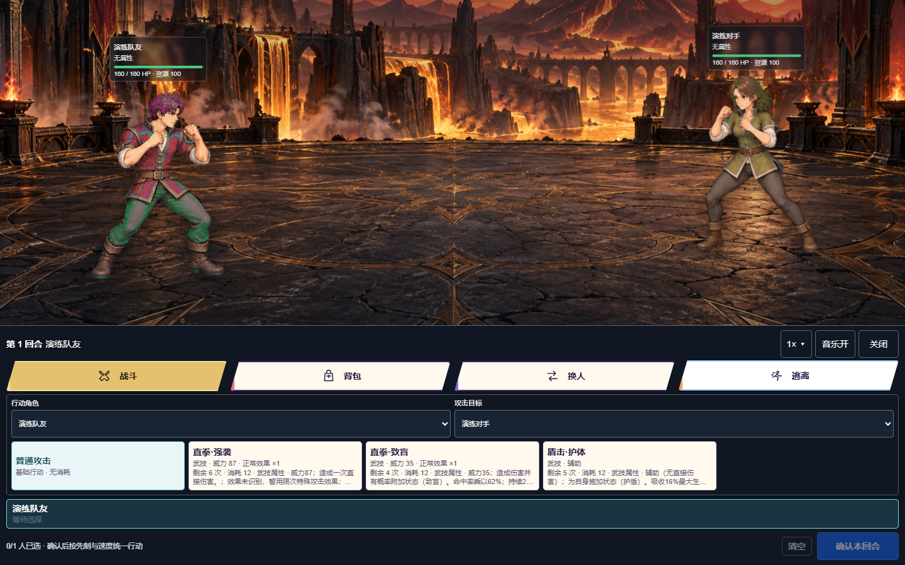

# DSH Tavern Game

**版本：0.1.1**

给 DSH Tavern 故事加入可操作的回合制战斗。插件从当前剧情与 MVU 整理队友、技能和战斗补给；剧情中发生战斗时切换到战斗场景，玩家完成一轮指令后再统一结算。战斗结束后，可以让 AI 概括实际战果并填入续写。

## 功能介绍

### 从剧情生成队伍和补给

选择「人类对决」或「玄幻 / 西幻 / 仙侠」玩法包，点击「AI读取并生成角色和背包」，按人物卡与当前游戏资料生成队友、技能和战斗中可用的补给，并从内置立绘中匹配角色外观。生成使用插件设置的统一模型；可以选择提供商、模型和该模型支持的推理强度。模型输出不完整或连接中断时，原有队伍与背包会保留，并提供精简重试。

### 选择资料来源

默认读取当前正文、近期上下文和 MVU。高级选项可以分别控制是否读取上下文、MVU、世界书和台账，并设置读取历史轮数。读取范围有上限；台账若没有可用的公开接口，可以粘贴相关内容。插件会提示资料不足或发生截取，不会反复调用工具。

### 编辑队友与设计角色

队伍最多保存 6 人，每方同时最多上场 3 人。队友卡片可以折叠，也可以单独修改名称、当前生命、最大生命、攻击、防御、速度和技能。AI角色设计会先给当前角色生成可编辑草稿，确认并保存后才生效；也可以通过单人角色编辑要求 Agent 重新设计。

### 回合制战斗

玩家为每名可行动队友选择技能、背包物品或换人；选招阶段可以修改指令，点击「确认本回合」后双方再按先制与速度统一行动。普通攻击作为独立基础行动，不占 4 个特殊技能槽。战斗最多 24 回合，避免控制、召唤或恢复效果把战斗拖成无限循环。

战斗界面提供「战斗、背包、换人、逃离」操作，显示角色头顶生命条、行动状态和战斗字幕。支持 1×、2×、3×、10×演出速度、镜头切换、攻击与受击音效及战斗音乐。速度只改变动画演出，不改变战斗判定。

### 技能状态与玩法包

技能效果来自插件内置的固定目录。玩法包可以选择目录中的效果与有限机制，涵盖伤害、治疗、护盾、控制、属性变化、持续伤害、净化、召唤、反击、吸血、先制、暴击、命中与闪避等类别。效果按回合数、次数和数值上限结算；AI生成技能必须映射到目录中的有效效果，避免模型随意编造无法执行的机制。

当前提供两种内置玩法包：人类对决，以及玄幻 / 西幻 / 仙侠。用户可以制作 JSON 玩法包并从插件界面导入；包中可配置可选技能效果、角色与敌人资料、技能别名等。玩法包提供规则与素材配置，不会执行包内脚本。

仓库的 [`skills/dsh-tavern-authoring`](skills/dsh-tavern-authoring/SKILL.md) 提供可分享的制作 Skill，包含玩法包模板、外观动作包构建工具和校验器，方便其他玩家制作自己的导入资源。

### 角色属性与技能威力

本版本为角色增加属性：每名角色有 1—2 种不同属性；技能各自有一个属性。目录共 12 种：无属性、武技、火、水、木 / 自然、雷、冰、土 / 岩、风、光、暗、灵。队友与手动生成的敌人会在同一次 AI 请求中同时生成属性和技能威力，不会为属性额外调用模型。新生成的攻击技能威力为 20—140 的整数，治疗与辅助技能威力为 0；当前资料和人物定位会影响生成值。

伤害按攻击技能属性与目标属性计算：命中克制关系时伤害为 2 倍，抵抗时为 0.5 倍；双属性目标的倍率相乘，并限制在 0.25—4 倍。角色使用自身属性的技能有 1.2 倍加成。无属性保持中立，不设置绝对免疫。手动编辑队友时可以继续查看和修改属性与技能威力；既有数据会在故事更新时保留。

每招都有独立威力：在攻防、命中、暴击和目标相同的条件下，威力 120 的技能会比威力 60 的技能造成更高伤害。战斗技能按钮会显示属性、威力和对当前目标的克制倍率；治疗和护盾等辅助技能标为辅助，不会因为威力字段产生直接伤害。最终伤害仍受本地平衡上限约束。

### 背包与战果

AI生成的背包只包含战斗中能使用的有限补给，例如治疗、恢复资源和净化；钥匙、货币、身份牌、材料等剧情物品不会变成战斗道具。战斗中会显示物品说明、数量、效果和使用目标，数量用尽后不能继续使用。

战斗结束后可以生成战果摘要。摘要按真实回合记录、胜负、剩余生命和已记录事件概括，不会另判胜负或自动发送正文；你可以检查并编辑后点「填入续写」，再由自己发送。

### 剧情自动开战与手动开战

玩家明确要求当场开战，或当前正文写出决斗、对战、交战、切磋、比武、开战等实际战斗时，剧情结算后会启动回合制战斗。已结束、历史、假设、计划或明确拒绝的战斗不会触发。AI若漏写标记，插件也会在符合规则时从正文识别；无法识别具体敌人时使用「剧情对手」作为兜底。

「手动开战」允许直接输入敌人描述或人数，也可使用简单格式，例如 `山贼*3 | 挥剑、格挡`。手动战斗可以选择是否把结果用于正文；关闭时是独立演练，不自动续写或发送。

### 数值随正文更新

这是一个可选开关。开启后，每节正文结算时，酒馆后台可依据当前正文更新已有队友的数值、技能和物品。已有 MVU 数值优先；插件不会凭空新增队友，也不会把生命为 0 的角色自动恢复。关闭时，故事正文不会自动改写插件中的战斗数据。

### 角色立绘、动作、场景和音效导入

插件包含 60 套内置角色与动物默认外观。0.1.1 新增蝎子、熊、狮子、蜥蜴，以及金甲棍武者和长杖贤者六套动作图集；角色生成会按性别、物种、武器和职业从默认外观中选择，并在同一次 AI 请求中返回选择结果。选择与配色会保存到角色上，改名或重新生成不会反复换外观。动物可以使用更广的毛色范围；人物随机配色会覆盖更多发色与服装颜色，同时保留基本肤色、眼白和轮廓特征。颜色变化由本地渲染完成，不额外请求模型。

内置战斗场景共 5 张；0.1.1 新增「云海天宫」「极光冰城」「熔火圣殿」。用户也能为角色导入单张立绘、动作图集或带动作的骨架配置，并导入战斗场景背景、音乐、攻击音效和受击音效。导入内容会校验格式和大小，失败时保留原资源；骨架导入以兼容的配置和资源为准，不保证适配所有外部骨架或动作绑定。

个人外观和声音素材保存在当前浏览器的本地存储中，不写进人物卡 MVU，也不会自动随 Tavern 存档导出。清理浏览器站点数据前，请先自行备份需要保留的素材。

### 插件更新与回滚

更新器会校验发布包中每个运行文件的 SHA-256 完整性清单，在插件目录旁准备并验证暂存版本后再切换目录。每次更新前会保存运行文件备份，最多保留五份完整备份；更新发布失败时会自动恢复原目录。插件界面支持查看本地备份并回滚，回滚前再次检查备份字节。故事数据、人物卡和 MVU 不属于插件更新文件。

## 安装

打开 DSH Tavern → 设置 → DSH Tavern → 插件，粘贴 `https://github.com/weixinlll/dsh-tavern-game`，点击「安装」并刷新页面。公开 Release 发布后，Tavern 会按 `package.json` 中的版本检查更新。也可以在插件界面检查更新、查看可用的本地备份或回滚。更新后需要重启 DSH 才会加载宿主侧代码。

如果无法连接 GitHub，可下载本仓库 ZIP，再在相同设置页选择「上传 ZIP」。

0.1.1 的更新器直接下载已验证版本标签的资源包，大包下载允许最多十分钟；受支持的宿主运行时会沿用已配置的HTTP(S)代理与NO_PROXY。若0.1.0的旧更新器一直超时，可先通过Tavern插件管理更新，或下载ZIP导入一次；之后再使用新版的检查更新与回滚。

## 开始使用

1. 在 DSH Tavern 游戏输入区打开「战斗」插件。
2. 选择玩法包，点击「AI读取并生成角色和背包」，或先展开高级选项调整资料来源和模型。
3. 检查并编辑队友与补给；需要时折叠或单独编辑队友卡片。
4. 在剧情中开始战斗，或展开「手动开战」输入对手。
5. 每轮为上场队友选好行动，点击「确认本回合」统一结算。

需要文字模型用于生成角色、敌人或战果时，请先在 DSH Tavern 配置可用的后台模型。手动固定格式开战和本地战斗结算不依赖生成模型。

## 开发与验证

需要 Node.js。运行 `npm test` 执行自动化测试，运行 `npm run check` 检查入口、模块引用和资源清单。插件没有额外 npm 运行依赖。

## 许可

本项目代码按仓库中的 MIT License 发布。立绘、场景和音频等资源如有单独署名或许可要求，以对应资源目录中的说明为准。
